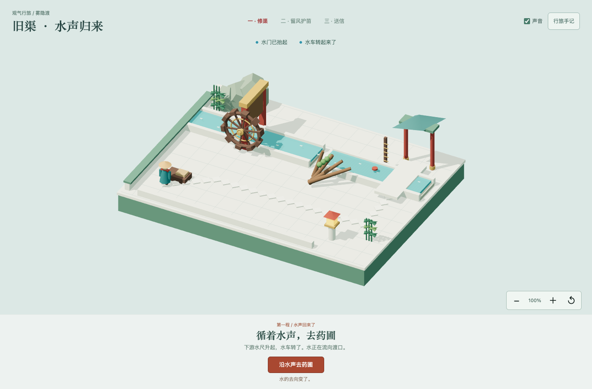
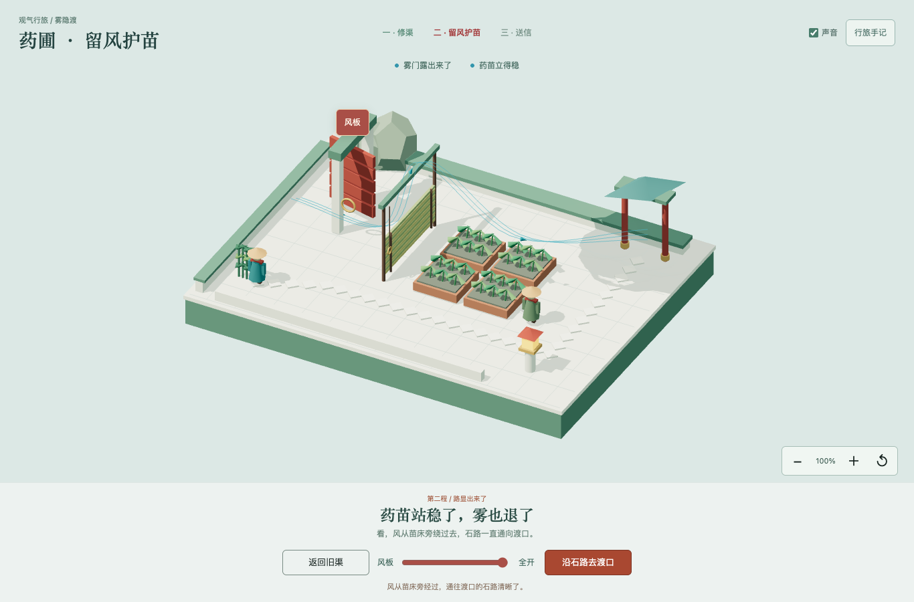

# 观气行旅：藏风小院 / 雾隐渡



[在线试玩（GitHub Pages）](https://yiqian-liang.github.io/guanqi-journey-demo/?v=0.8.0)

一款把传统形势观察转译成空间谜题的中文叙事探索 Demo。0.8 将“藏风小院”的直接操作延续到整个送信主线：旧渠修水、药圃留风护苗、旧渡口交信。四处场景采用统一的斜俯视立体表现，可放大到 160%、拖动画面、恢复完整视野。

这不是现实风水或命运预测工具。命盘用于虚构角色构筑、法式消耗和人物协作；所有传统文本均按历史文化材料处理。

## 可玩内容

- 原创低多边形 3D 小院，固定正交镜头同时展示来风口、屏风、灯台、桥和对岸。
- 双目标小局：整面挡风可以护灯，但会让风铃停下；折开侧扇，给风留下另一条路。支持靠近来风处向外折、靠近灯台向内折等多种摆法，不检查唯一位置答案。
- 鼠标与触屏可直接推屏、左右拖动折屏，也可用键盘操作两个滑杆。推屏、折屏切换操作，场景里只显示当前握柄；来风简化为三束可见流线，减少标记堆叠。
- 拖火折子至灯台，角色会携火走近、引火，约一秒后才知道灯能否站稳；直接点击灯台也可点火。
- 连续风线与流动箭头、摆动灯穗和铃纸、稳定灯焰、点火火星、逐块升起的桥面和滑开的亭门。
- 合成风声、木轮/折页短音、点火声与清脆铃音，带静音开关，不下载外部音频。
- 角色沿院中石路行走；灯稳定且风铃响起后，点对岸或“走到对岸”即可过桥。
- 屏风拉过头会遮光；撤屏会让灯熄灭并关闭通路，可随时重试。
- 旧渠：拾起轴芯并拖到轴座，水门抬起；牵开活根后，水面向下游推进、水尺升起、水车转动。修门不等于已经通水。
- 药圃：拖动风板、收窄风口或拉下竹屏。雾的退去、药苗的弯折和绕屏风线同时反馈，不再依赖猜测调息次数。温和通风与全开加屏均是有效方案。
- 旧渡口：角色沿栈桥走到船边，把信交给摆渡人；背包、首次路线和结局记录使用实际游戏状态。
- 主线使用场景内物件与底部当前目标，命盘、技能、物品与存档收进原生“行旅手记”窗口。旧地图与支线保留为可选入口，并能返回当前主线。
- 开场、雾村、旧渠、药圃、渡口和结尾剧情对白。
- 旧地图仍保留水路、风路、识路三种探索方式与可选峡谷近路，支线未冒称已全部重做。
- 随机、模板、部分锁定和分享码四种虚构角色命盘创建方式。
- 四柱面板展示十神、干支、藏干、纳音、地势、空亡与神煞，并明确展示解释边界。
- 15 个五行法式、4 位有自己作息的 NPC、0 至 2 人自由同行、6 组神煞支线。
- 双代际本地存档、校验和、导入导出和旧版迁移。

## 立即试玩

项目不需要安装依赖。进入游戏目录后启动任意静态服务器：

```bash
cd guanqi-game
python3 -m http.server 4173 --bind 127.0.0.1
```

浏览器打开 `http://127.0.0.1:4173/`。

小院：选推屏或折扇，再拖握柄；把火折子拖到灯台，也可直接点击点灯。正式主线：点击或拖动场景物件，人物会走近再动手；底部按钮提供同样的操作入口，滑杆可用键盘。右下角放大后，可拖动空白处查看细节。

保存与读取位于“行旅手记”。旧存档会保留物品和任务进度，并推断应继续的正式场景。可选旧地图仍使用方向键 / `WASD` 移动、`E` 互动、`Q` 观局。

## 第一关设计

小院让一处动作及其后果同时留在画面里：

1. 推屏挡住直吹灯台的风；尝试引火，观察灯穗和火苗。整面挡住时，灯能亮，但铃会停。
2. 折开侧扇，看绕行风线、铃纸摆动并听铃声。保留背风处和照桥方向，灯与铃同时成立时桥面才升起。
3. 也可以退回、换一处推屏位置和折向，尝试不同摆法。最后点击对岸，角色沿实际石路和桥面走过去。

屏扇几何与九束来风线段相交，决定灯边是否背风；折角决定给风铃留下的通风量，绕行流线采用预设曲线而非流体模拟。撤屏会灭灯；合上侧扇可保留灯火但关闭通路。移动路径与桥的可达性共用一张石路图。命盘创建折叠为可选，不妨碍直接进入第一局。

参考《纪念碑谷》的单屏空间谜题表达，具体构图与机关为本项目原创。古籍页说明《葬书》原句、场景取意与改编边界；屏风、灯、桥不冒称古籍记载的固定风水局。

## 正式主线

1. **水声归来**：在同一画面内看见来水、空轴座、堵根和下游水尺。装轴芯只打开水门；把根牵到渠边，才接通水路。
2. **留风护苗**：把小院“护住灯，也给铃留风”的经验迁移到药圃。风可以散雾，但过强会伤苗；试着留缝，或先给药苗落屏。
3. **一封远信**：走过已经显露的路，在船边完成交信。完成后仍可返回前一处、打开手记，或进入旧地图的可选探索。



机关不是孤立动画：轴芯消耗、根路状态、供水、风量、药苗状态、通路和交信收据来自原有同一套游戏规则。主线并未增加命盘或技能门槛。场景分为三处可回访的立体舞台，不是新增无边界开放世界。

## 研究基础

本仓库保留可复核的公版影印本、页码和逐句校读记录：

- 《郭璞葬经》合刊本：62 页逐页检查，正文 155 条校读。
- 《子平真诠》：前七篇 PDF 10-25，43 个句群逐页校读。
- 《滴天髓阐微》：已完成版本和目录定位，尚未声称通读。

《子平真诠》校读特别记录“万物/万木”“日干/十干”“官星反轻/反清”“六阳六阴/五阳五阴”等会改变规则的底本异文。详细进度见 [`research/close-reading/README.md`](research/close-reading/README.md)，游戏转译原则见 [`research/READING_NOTES.md`](research/READING_NOTES.md)。

## 验证

```bash
node guanqi-game/selfcheck.cjs
python3 tools/validate_handoff.py
```

当前结果：

- 游戏自检通过，覆盖命盘生成、导入导出、预算、十神方向、命盘表、两阶段指引、15 法式接线、资源存在和旧存档迁移。
- 设计数据校验通过，解析 27 个 JSON 文件并检查 66 项验收定义。
- 游戏自检覆盖双目标判断、24 组不同位置/折向组合、延时点火、合屏留灯但关桥、撤屏灭灯、完成局锁定及上一版小院存档迁移。
- 游戏自检覆盖修门与通水的先后、背包消耗、反复开合风板、两种护苗方案、通路守卫、单次交信、旧进度迁移和场景字段校验。
- `browsercheck.cjs` 使用 Playwright 完整走通小院、放大/拖动视野、拖轴芯、牵根、转水车、风板实拖与反复切换、拉下竹屏、真实本地保存/重开、交信、结局，以及旧地图往返。
- 1366×900、390×844 与 320×568 检查实际立体视口的 25 个 WebGL 像素采样点、标记间距及页面宽度；此项需在本地启动服务，且测试环境可解析 Playwright 并安装 Chrome。

自动化不能证明游戏有趣。陌生玩家能否复述规则并迁移到新谜题，仍需要正式试玩研究。

## 项目结构

- `guanqi-game/`：可直接运行和部署的静态浏览器游戏。
- `research/`：公版影印本、来源记录与逐句校读台账。
- `data/`：角色、地图、技能、NPC、神煞和事件的权威数据。
- `contracts/`、`schemas/`：类型与数据边界。
- `docs/IMPLEMENTATION_STATUS.md`：实现范围、真实检查和已知边界。
- `GAME_SPEC.md`、`PLAYER_EXPERIENCE.md`：完整产品与体验设计。

## 素材与边界

小院和送信主线为本项目原创 Three.js 几何场景，本文图片均是实际运行截图。旧地图底图和人物头像为本项目原创 AI 生成素材，没有使用商业游戏地图、角色、Logo 或字体。Three.js 0.186.0 以 MIT License 随仓库保存；完整台账见 [`guanqi-game/assets/ASSET_LICENSES.md`](guanqi-game/assets/ASSET_LICENSES.md)。

当前 Demo 是单人原型，不宣称已实现真人联机；角色仍使用简化低多边形几何体，重点是镜头、空间、剧情和任务可读性。
